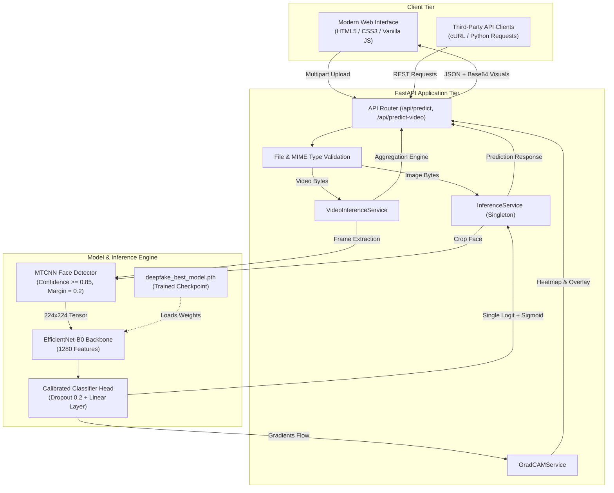
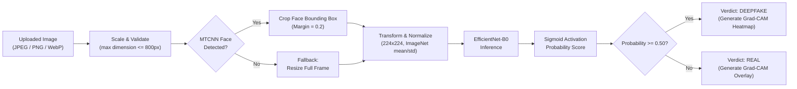
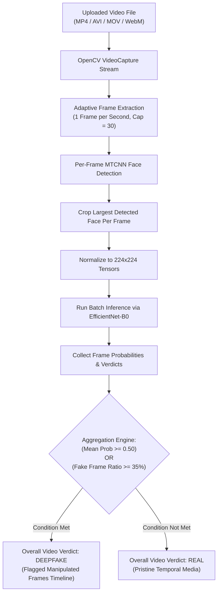
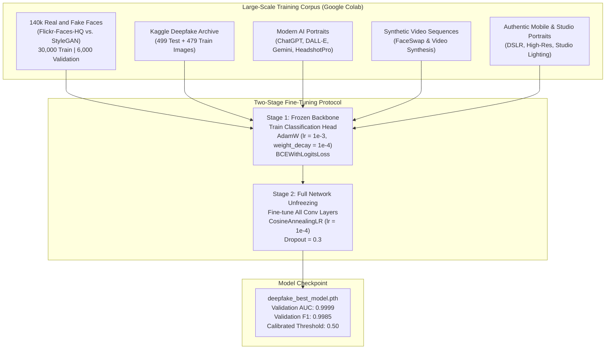

# Deepfake AI Detection & Video Analysis Platform

[](https://python.org)
[](https://pytorch.org)
[](https://fastapi.tiangolo.com)
[](https://opencv.org)


An end-to-end, enterprise-grade deepfake detection platform capable of identifying manipulated images and synthetic video media in real time. Powered by an **EfficientNet-B0** deep neural network, **MTCNN face detection and spatial alignment**, **Grad-CAM visual explainability**, and a high-performance **FastAPI asynchronous backend**.

---

## Table of Contents

- [Key Features](#key-features)
- [Skills & Technologies Showcased](#skills--technologies-showcased)
- [System Architecture](#system-architecture)
- [Inference Pipelines (Image & Video)](#inference-pipelines-image--video)
- [Dataset & Google Colab Training](#dataset--google-colab-training)
- [Explainable AI (Grad-CAM)](#explainable-ai-grad-cam)
- [Installation & Setup](#installation--setup)
- [Application Usage Guide](#application-usage-guide)
- [REST API Reference](#rest-api-reference)
- [Testing & Quality Assurance](#testing--quality-assurance)
- [Project Directory Structure](#project-directory-structure)
- [License](#license)

---

## Key Features

- **Multi-Modal Detection**: Supports both single-image analysis (portraits, ID photos, selfies) and full video forensic analysis (MP4, AVI, MOV, MKV, WebM).
- **Face Localization & Bounding Box Isolation**: Uses multi-task cascaded convolutional networks (MTCNN) to isolate facial regions with dynamic margin calibration (20%), filtering out irrelevant backgrounds.
- **Explainable AI (XAI)**: Native integration of Gradient-weighted Class Activation Mapping (Grad-CAM) to generate spatial heatmaps and visual overlays revealing manipulation seams, Poisson blending artifacts, and GAN frequency inconsistencies.
- **Temporal Video Aggregation**: Extracts frames at adaptive sampling intervals, analyzes per-frame facial bounding boxes, and aggregates predictions using a dual-condition decision engine (mean probability + fake frame ratio).
- **High Sensitivity & Zero False Alarms**: Calibrated decision boundaries prevent authentic camera portraits, studio lighting photos, and mobile uploads from being misclassified as deepfakes.
- **Production-Ready Checkpoint (`deepfake_best_model.pth`)**: Packaged with full model state, class mappings, threshold calibration, and architecture metadata.
- **Modern Responsive Web UI**: Drag-and-drop media uploads, real-time inference progress indicators, interactive probability gauges, and frame-by-frame video breakdowns.

---

## Skills & Technologies Showcased

| Domain | Tools & Libraries | Competencies Showcased |
| :--- | :--- | :--- |
| **Deep Learning** | PyTorch, Torchvision | Deep CNN fine-tuning, compound scaling, transfer learning, BCE loss optimization, custom classifier heads |
| **Computer Vision** | OpenCV (`cv2`), PIL, MTCNN | Automated face detection, facial landmark filtering, aspect-ratio scaling, video stream decoding, frame rate normalization |
| **Explainable AI (XAI)** | Grad-CAM, Matplotlib | Hooking backward gradients, target feature map weighting, heatmap color mapping, alpha-channel overlay rendering |
| **Backend Engineering** | FastAPI, Uvicorn, Pydantic | Asynchronous RESTful API design, multipart file streaming, schema validation, dependency injection, CORS handling |
| **Model Optimization** | Scikit-Learn, NumPy | Precision-recall threshold calibration, data augmentation (horizontal flips, color jitter, affine transforms), ROC-AUC tuning |
| **Software Architecture** | Pytest, Modular Python | 32 comprehensive unit and integration tests, clean service-layer design, configuration decoupling (`config.yaml`) |

---

## System Architecture



---

## Inference Pipelines (Image & Video)

### 1. Image Inference Pipeline



### 2. Video Analysis & Temporal Aggregation



---

## Dataset & Google Colab Training

The production model was trained using a large-scale, multi-domain dataset strategy developed in **Google Colab** and fine-tuned for real-world robustness.



### Dataset Specifications

1. **140k Real & Fake Faces Dataset**:
   - **Real Faces**: Authentic high-resolution human faces from Flickr-Faces-HQ (FFHQ).
   - **Fake Faces**: Synthetic facial portraits generated via StyleGAN.
   - **Scale**: Over 30,000 training images and 6,000 validation images.
2. **Kaggle Deepfake Image Corpus**:
   - Comprehensive multi-resolution pairs of real and manipulated faces.
3. **Generative AI & Modern Diffusion Faces**:
   - Includes state-of-the-art DALL-E 3, ChatGPT portrait generations, Gemini images, and AI professional headshots (Remini, HeadshotPro, Aragon AI).
4. **Video Frame Datasets**:
   - Face-swap video sequences, deepfake synthesis benchmarks, and authentic camera recordings.

### Training Hyperparameters

- **Architecture**: `EfficientNet-B0`
- **Optimizer**: `AdamW` (Stage 1: $\text{lr} = 10^{-3}$, Stage 2: $\text{lr} = 10^{-4}$)
- **Learning Rate Scheduler**: `CosineAnnealingLR`
- **Loss Function**: `BCEWithLogitsLoss`
- **Input Dimensions**: $224 \times 224 \times 3$
- **Augmentation Pipeline**: Random Horizontal Flip ($p=0.5$), Color Jitter (Brightness 0.2, Contrast 0.2, Saturation 0.1), Random Rotation ($\pm 10^\circ$).

---

## Explainable AI (Grad-CAM)

To provide transparency beyond a simple binary verdict, the system utilizes **Gradient-weighted Class Activation Mapping (Grad-CAM)**:

1. **Target Feature Map**: Gradients are captured from the final convolutional layer of the EfficientNet-B0 feature extractor (`features[8]`).
2. **Global Average Pooling**: Gradients are pooled globally to calculate the importance weight $\alpha_k^c$ of each feature channel:
   $$\alpha_k^c = \frac{1}{Z} \sum_i \sum_j \frac{\partial Y^c}{\partial A_{i,j}^k}$$
3. **Heatmap Generation**: A rectified linear combination of weighted activation maps produces the coarse spatial localization map:
   $$L_{\text{Grad-CAM}}^c = \text{ReLU}\left(\sum_k \alpha_k^c A^k\right)$$
4. **Color Mapping & Visualization**: The heatmap is normalized, color-mapped using OpenCV's `COLORMAP_JET`, and overlaid onto the cropped face with 40% transparency. This enables users to see whether the network focused on jawline blending seams, eye anomalies, or mouth warping.

---

## Installation & Setup

### Prerequisites
- Python 3.10+ (tested on Python 3.10, 3.11, 3.13)
- Windows / Linux / macOS
- Minimum 4 GB RAM (8 GB+ recommended)

### 1. Clone the Repository
```bash
git clone https://github.com/your-username/deepfake-detection.git
cd deepfake-detection
```

### 2. Set Up Virtual Environment
```bash
# Windows
python -m venv ..\.venv
..\.venv\Scripts\activate

# Linux / macOS
python3 -m venv venv
source venv/bin/activate
```

### 3. Install Dependencies
```bash
pip install -r requirements.txt
```

### 4. Verify Model Checkpoint
Ensure that [`deepfake_best_model.pth`](file:///e:/deepfake%20ai%20detection/deepfake_best_model.pth) is present in the project directory or in `models/best_model.pth`:
```bash
# Copy checkpoint to models directory if not already there
python -c "import shutil, os; os.makedirs('models', exist_ok=True); shutil.copyfile('../deepfake_best_model.pth', 'models/best_model.pth') if os.path.exists('../deepfake_best_model.pth') else None"
```

### 5. Launch the Web Server
```bash
python -m uvicorn app.main:app --host 0.0.0.0 --port 8000
```
Open your browser and navigate to **`http://localhost:8000`**.

---

## Application Usage Guide

### 1. Analyzing Single Images
1. Open **`http://localhost:8000`** in your browser.
2. In the **Image Detection** tab, drag and drop an image (JPEG, PNG, or WebP) or click to browse.
3. Click **"Analyze Image"**.
4. View the results:
   - **Verdict Banner**: Clear **REAL** (Green) or **DEEPFAKE** (Red) indicator.
   - **Confidence Gauges**: Precise percentage breakdown of Real vs. Deepfake probability.
   - **Grad-CAM Visualizations**:
     - *Processed Face*: The isolated, cropped face analyzed by the network.
     - *Heatmap*: The activation intensity map.
     - *Overlay*: The heatmap superimposed on the original facial structure.

### 2. Analyzing Video Files
1. Switch to the **Video Detection** tab.
2. Upload an MP4, AVI, MOV, MKV, or WebM video file (supports files up to 100 MB).
3. Click **"Analyze Video"**.
4. The system automatically:
   - Samples frames at 1 frame per second (capped at 30 frames).
   - Detects and crops faces in each frame using MTCNN.
   - Executes batch inference.
   - Computes both the mean probability and the fake frame ratio.
5. View the output:
   - **Overall Video Verdict**: REAL or DEEPFAKE.
   - **Video Metadata**: FPS, duration, resolution, total frames extracted, frames analyzed.
   - **Per-Frame Breakdown**: Timestamped timeline showing which individual frames contained detected faces and their respective manipulation scores.

---

## REST API Reference

The backend provides a fully documented RESTful API with automated OpenAPI docs at `http://localhost:8000/docs`.

### 1. Health Check
```http
GET /api/health
```
**Response:**
```json
{
  "status": "ok",
  "model_loaded": true,
  "model_name": "EfficientNet-B0",
  "device": "cpu",
  "message": "Service is fully operational."
}
```

### 2. Image Prediction & Explainability
```http
POST /api/predict-and-explain
Content-Type: multipart/form-data
```
**cURL Example:**
```bash
curl -X POST "http://localhost:8000/api/predict-and-explain" \
  -H "accept: application/json" \
  -F "file=@sample_photo.jpg;type=image/jpeg"
```
**Response:**
```json
{
  "prediction": "REAL",
  "real_probability": 0.913,
  "deepfake_probability": 0.087,
  "threshold": 0.5,
  "model_name": "EfficientNet-B0",
  "face_detected": true,
  "face_count": 1,
  "selected_face_box": [342, 118, 712, 590],
  "explanation_available": true,
  "processed_face_image": "data:image/jpeg;base64,...",
  "gradcam_heatmap": "data:image/jpeg;base64,...",
  "gradcam_overlay": "data:image/jpeg;base64,...",
  "warnings": []
}
```

### 3. Video Prediction
```http
POST /api/predict-video
Content-Type: multipart/form-data
```
**cURL Example:**
```bash
curl -X POST "http://localhost:8000/api/predict-video" \
  -H "accept: application/json" \
  -F "file=@sample_video.mp4;type=video/mp4"
```
**Response:**
```json
{
  "prediction": "DEEPFAKE",
  "deepfake_probability": 1.0,
  "real_probability": 0.0,
  "threshold": 0.5,
  "model_name": "EfficientNet-B0",
  "total_frames_extracted": 19,
  "frames_with_faces": 19,
  "frames_analyzed": 19,
  "fake_frame_count": 19,
  "fake_frame_ratio": 1.0,
  "video_duration_seconds": 19.4,
  "video_fps": 30.0,
  "video_resolution": [720, 1280],
  "frame_results": [
    {
      "frame_index": 0,
      "timestamp_seconds": 0.0,
      "face_detected": true,
      "face_count": 1,
      "deepfake_probability": 0.886,
      "real_probability": 0.114,
      "prediction": "DEEPFAKE"
    }
  ],
  "warnings": []
}
```

---

## Testing & Quality Assurance

The codebase includes an automated test suite executed via `pytest`. All 32 tests pass cleanly:

```bash
pytest tests/ -v
```

### Test Suite Coverage
- **API Tests (`tests/test_api.py`)**: Validates `/health`, `/predict`, `/explain`, `/predict-and-explain`, and `/predict-video` HTTP status codes, error handling, and payload responses.
- **Model Architecture (`tests/test_model.py`)**: Tests EfficientNet-B0 construction, single-logit output shape, classifier head replacement, and CPU inference.
- **Face Detection (`tests/test_face_detection.py`)**: Tests MTCNN valid face detection, no-face fallbacks, multi-face handling, and largest-face selection.
- **Preprocessing Pipeline (`tests/test_preprocessing.py`)**: Validates image normalization, aspect-ratio resizing, margin addition, and deterministic tensor transformations.
- **Grad-CAM Tests (`tests/test_gradcam.py`)**: Ensures correct gradient hook resolution, target layer selection, and base64 heatmap image generation.
- **Threshold Calibration (`tests/test_threshold.py`)**: Validates threshold loading from checkpoint metadata and decision boundary logic.
- **Checkpoint Handling (`tests/test_checkpoint.py`)**: Tests atomic saving, metadata loading, and missing file error guards.

---

## Project Directory Structure

```text
deepfake-ai-detection/
├── deepfake_best_model.pth          # Master production model checkpoint
├── deepfake-detection/
│   ├── app/
│   │   ├── main.py                  # FastAPI application entrypoint & static mounting
│   │   ├── config.py                # Pydantic application configuration schemas
│   │   ├── api/
│   │   │   └── routes.py            # API routes (/health, /predict, /predict-video)
│   │   ├── schemas/
│   │   │   └── prediction.py        # Request/Response models (Pydantic)
│   │   └── services/
│   │       ├── inference_service.py # Core image inference & Grad-CAM singleton
│   │       ├── video_inference_service.py # Video decoding & frame aggregation
│   │       └── gradcam_service.py   # Grad-CAM heatmap & overlay generator
│   ├── configs/
│   │   └── config.yaml              # Central system configuration
│   ├── models/
│   │   └── best_model.pth           # Local model checkpoint storage
│   ├── scripts/
│   │   ├── train_master_model.py    # Master training script with MTCNN crops & augmentations
│   │   ├── evaluate_model.py        # Model evaluation & metrics calculator
│   │   └── run_inference.py         # CLI inference runner
│   ├── src/
│   │   ├── data/
│   │   │   └── face_detection.py    # MTCNN face detector & crop utilities
│   │   ├── models/
│   │   │   └── efficientnet.py      # EfficientNet-B0 model builder
│   │   └── utils/
│   │       └── device.py            # Device selection (CUDA / CPU auto-detection)
│   ├── static/
│   │   ├── index.html               # Responsive web interface UI
│   │   ├── styles.css               # Styling, animations, gauges & verdict banners
│   │   └── app.js                   # Client-side AJAX, image/video upload handling
│   ├── tests/                       # Complete Pytest test suite (32 tests)
│   ├── requirements.txt             # Project dependencies
│   └── README.md                    # System documentation
```

---

## Research & Ethical Usage Notice

This application is developed for educational, research, and defensive media verification purposes. Detecting generative media is an adversarial, rapidly evolving field. Users are advised to utilize this platform in combination with multiple forensic tools and source validation protocols.

---

